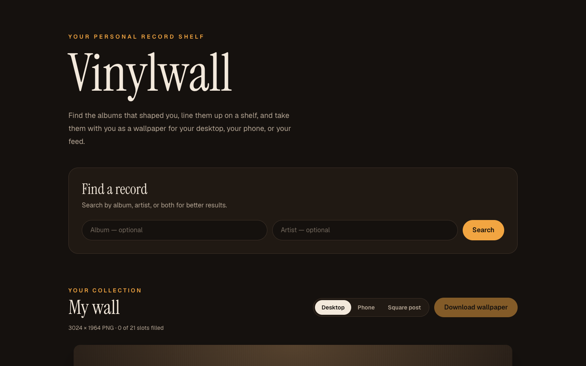
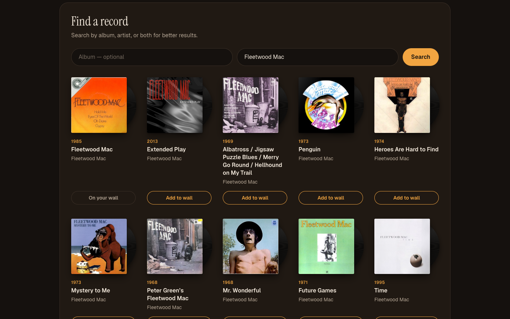
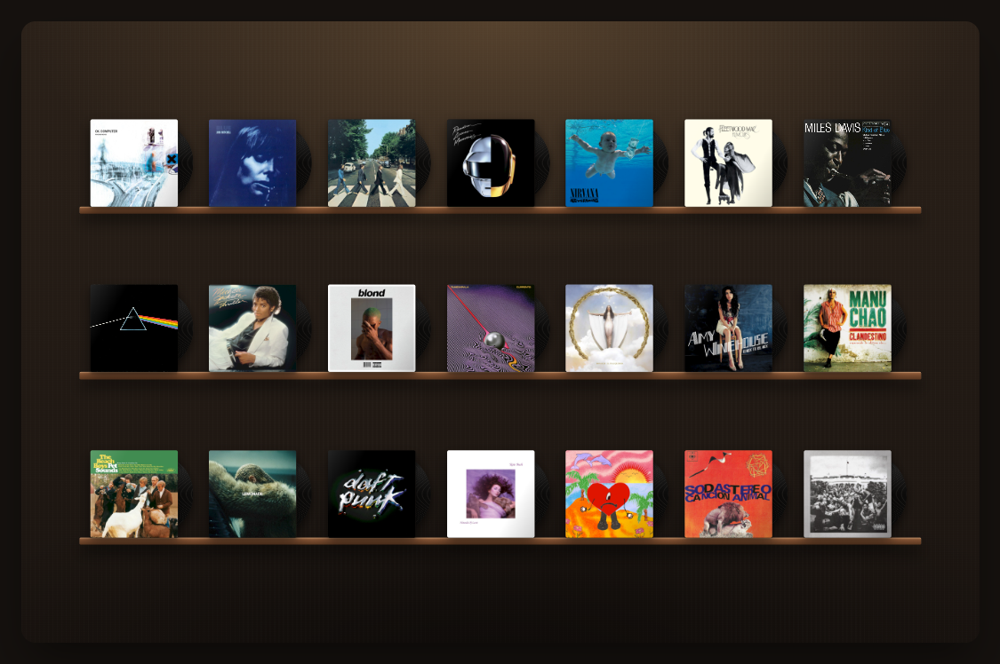
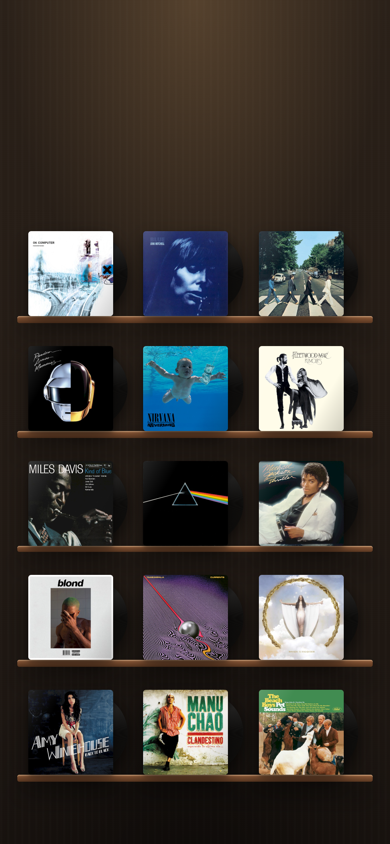
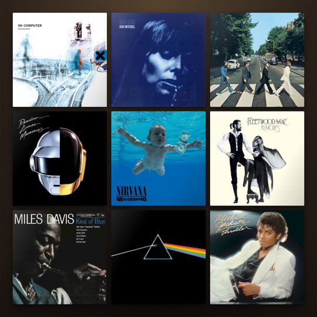
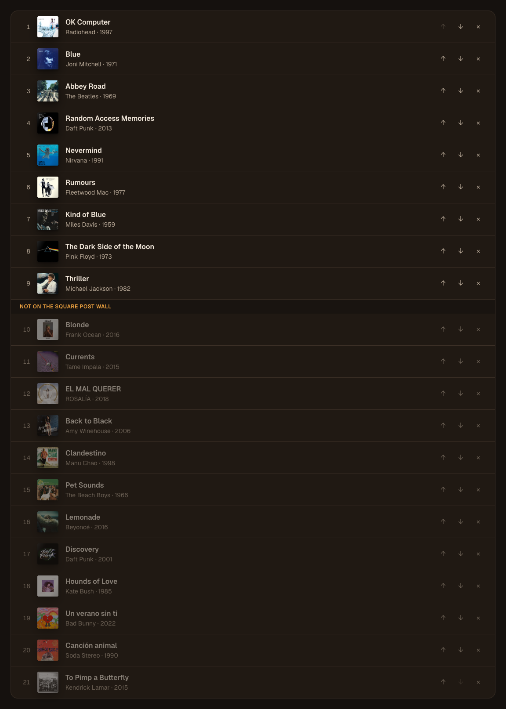

# Vinylwall

**Your personal record shelf.** Find the albums that shaped you, line them up on a shelf with their discs peeking out of the sleeves, and export the shelf as a wallpaper for your desktop, your phone, or your feed.



## Features

- **Album search**: look up any album by title, artist, or both, using [MusicBrainz](https://musicbrainz.org). Searching by artist alone hides live albums, compilations and demos so the studio albums come first.
- **Real cover art**: covers come from the [Cover Art Archive](https://coverartarchive.org). Albums without art get a generated sleeve in a color unique to that album.
- **A shelf that looks like a shelf**: every record sits on a wooden ledge with its vinyl showing. Hover over one and the disc slides out and spins.
- **Three export formats**, previewed exactly as they will download:

  | Format | PNG size | Layout |
  |---|---|---|
  | Desktop | 3024 × 1964 | 3 shelves × 7 records |
  | Phone | 1170 × 2532 | 5 shelves × 3 records, with room for the lock-screen clock |
  | Square post | 1080 × 1080 | 3 × 3 cover grid |

- **The crate**: reorder your collection to choose which records make it onto the wall. A divider shows where the current format runs out of space.
- **Saved automatically**: your collection is kept in `localStorage` and stays in sync across open tabs.

## Screenshots

### Search for a record



### Your wall



### Exported wallpapers

<p>
  
  &nbsp;
  
</p>

### The crate



## Tech stack

| | |
|---|---|
| Framework | [Next.js 16](https://nextjs.org) (App Router, Route Handlers) |
| UI | [React 19](https://react.dev), [Tailwind CSS 4](https://tailwindcss.com) |
| Language | TypeScript |
| Data | [MusicBrainz API](https://musicbrainz.org/doc/MusicBrainz_API), [Cover Art Archive](https://coverartarchive.org) |
| Image export | [html-to-image](https://github.com/bubkoo/html-to-image) |

## Getting started

You need Node.js 20 or newer.

```bash
git clone https://github.com/EmiliaCar/vinylwall.git
cd vinylwall
npm install
npm run dev
```

Then open [http://localhost:3000](http://localhost:3000). No API keys are needed.

| Command | Description |
|---|---|
| `npm run dev` | Start the development server |
| `npm run build` | Create a production build |
| `npm run start` | Serve the production build |
| `npm run lint` | Run ESLint |

## How it works

1. **Search** goes through [`/api/search`](app/api/search/route.ts), which queries MusicBrainz from the server. That lets the app send the identifying `User-Agent` MusicBrainz requires and retry once if it hits the one-request-per-second limit.
2. **Covers** go through [`/api/cover/[id]`](app/api/cover/[id]/route.ts), which follows Cover Art Archive's redirects to archive.org and serves the image from the app's own origin. Because the images are same-origin, `html-to-image` can draw them into the exported PNG.
3. **The wall** ([`Wall.tsx`](app/components/Wall.tsx)) renders at the format's exact CSS size, for example 1512 × 982 for desktop. On the page it's scaled down to fit, and the export renders the same element at a pixel ratio of 2 or 3, so the preview always matches the download.
4. **The collection** is read through [`useCollection`](app/lib/useCollection.ts), a `useSyncExternalStore` hook over `localStorage`.

## Project structure

```
app/
  api/
    search/route.ts      MusicBrainz search proxy
    cover/[id]/route.ts  Cover Art Archive proxy
  components/
    Record.tsx           Sleeve + disc, with a generated fallback sleeve
    Wall.tsx             Shelf and grid layouts, scaled preview frame
  lib/
    albums.ts            Album type, export formats, helpers
    useCollection.ts     localStorage-backed collection hook
  page.tsx               Search, wall, and crate
  globals.css            Record, shelf, and wall styles
docs/screenshots/        Images used in this README
```

## Acknowledgements

Album data comes from [MusicBrainz](https://musicbrainz.org) and cover art from the [Cover Art Archive](https://coverartarchive.org), both run by the MetaBrainz Foundation and the Internet Archive.

Vinylwall is a sibling project of [Shelfscape](https://github.com/EmiliaCar/shelfscape), which does the same for books.
